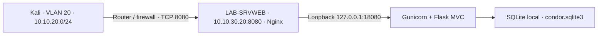

# Operación Cóndor: acceso al centro de mando

Guía de despliegue de la aplicación web en **LAB-SRVWEB**. Los comandos de
instalación se ejecutan en la víctima Ubuntu; las comprobaciones de acceso
externo se ejecutan desde Kali. Esta guía prepara el taller: no indica que la
VM ya haya sido modificada.

## 1. Topología y recursos

| Equipo / componente | Configuración |
|---|---|
| Víctima | LAB-SRVWEB, Ubuntu Server **26.04** |
| Dirección víctima | **10.10.30.20/24**, VLAN 30 |
| Cliente del ejercicio | Kali, dirección real dentro de **10.10.20.0/24**, VLAN 20 |
| Memoria víctima | **2 GiB** |
| Disco víctima | **20 GiB**, aproximadamente 6,3 GiB ocupados según el inventario |
| Portal Nginx | **http://10.10.30.20:8080/** |
| Aplicación Gunicorn | `127.0.0.1:18080`, dos procesos |
| Persistencia | SQLite en `/var/lib/condor-lab/condor.sqlite3` |
| Servicio | `condor-lab.service` |



Los recursos son una configuración de partida para un taller pequeño. Comprueba
el espacio libre real con `df`; el tamaño del disco virtual no equivale al
espacio disponible en `/`. Para esta web no se instala Docker, PostgreSQL ni
Redis. Las bases de Cociber CTF en `10.10.10.14` pertenecen a la plataforma;
el estado ficticio del taller queda en la víctima.

## 2. Preparar la comunicación entre VLAN

La víctima está en una subred diferente de Kali. El router o firewall que une
ambas VLAN debe permitir **origen `10.10.20.0/24` → destino `10.10.30.20`, TCP
8080**, con tráfico de respuesta permitido. Mantén la IP original de Kali en
esa conexión; si se aplica NAT, Nginx verá la IP traducida y rechazará el acceso.

La puerta de enlace y la IP concreta de Kali no se han indicado. Utiliza las
reales del laboratorio; no asumas que terminan en `.1`. El instalador no cambia
Netplan, interfaces, rutas, reglas del router ni la configuración SSH.

En la consola de **LAB-SRVWEB**:

```bash
cat /etc/os-release
hostnamectl
ip -4 address
ip -4 route
free -h
df -h /
```

Debes ver Ubuntu `26.04` y `10.10.30.20/24` asignada a una interfaz. Si la IP o
el sistema no coinciden, ajusta primero la configuración real de esa VM. Para
consultar Netplan usa `sudo netplan get`; los cambios de red deben realizarse
desde la consola del hipervisor y comprobarse antes de instalar la aplicación.
Referencia: [configuración de red de Ubuntu](https://ubuntu.com/server/docs/explanation/networking/configuring-networks/).

En **Kali**:

```bash
ip -4 address
ip route get 10.10.30.20
```

El origen (`src`) de la ruta debe pertenecer a `10.10.20.0/24`. Después de
instalar, se comprobará TCP 8080. Un `ping` bloqueado por el router no demuestra
que HTTP esté bloqueado.

## 3. Descargar el proyecto en LAB-SRVWEB

Toma una instantánea de la VM antes de instalar. Desde su consola o tu sesión
SSH administrativa:

```bash
sudo apt update
sudo apt install -y git ca-certificates python3 curl
mkdir -p "$HOME/laboratorios"
cd "$HOME/laboratorios"
git clone --depth 1 https://github.com/lavillamarin3-hash/operacion-condor.git
cd operacion-condor
git rev-parse HEAD
```

Si la carpeta ya existe, comprueba `git status` y su origen antes de actualizar;
no borres ni reemplaces cambios propios. El repositorio incluye los controladores,
modelos, vistas, recursos y el instalador. Se necesita salida a los repositorios
de Ubuntu y Python durante esta instalación.

## 4. Validar e instalar

Desde la raíz del proyecto en **LAB-SRVWEB**:

```bash
bash deploy/install.sh --server-ip 10.10.30.20 --lab-cidr 10.10.20.0/24 --validate-only
sudo bash deploy/install.sh --server-ip 10.10.30.20 --lab-cidr 10.10.20.0/24
```

`--lab-cidr` es la **red cliente autorizada**, aunque esté en otra VLAN. La
validación de parámetros no comprueba las rutas ni ejecuta una instalación.

El instalador crea un usuario de servicio sin shell, un entorno Python aislado,
la base SQLite, secretos de sesión, una contraseña ficticia elegida del
diccionario del taller y una flag aleatoria. Usa Gunicorn detrás de Nginx y
activa el servicio mediante systemd.

| Ubicación | Contenido |
|---|---|
| `/opt/condor-lab/releases/` | Versiones del código y su entorno Python |
| `/opt/condor-lab/current` | Enlace a la versión activa |
| `/var/lib/condor-lab/` | Base SQLite persistente |
| `/etc/condor-lab/condor.env` | Secretos privados, propietario root, modo 0600 |
| `/etc/nginx/sites-available/condor-lab.conf` | Sitio de laboratorio y control de acceso |

No se modifica SSH, UFW ni sitios Nginx ajenos. Si 8080 o 18080 están ocupados
por otra aplicación, el instalador se detiene. Una reinstalación reconocida
conserva los datos y los secretos; no reinicia el ejercicio.

## 5. Firewall de LAB-SRVWEB

En **LAB-SRVWEB**, revisa primero las reglas existentes:

```bash
sudo ufw status numbered
sudo ufw allow from 10.10.20.0/24 to 10.10.30.20 port 8080 proto tcp comment 'Condor desde Kali VLAN20'
sudo ufw status verbose
```

La regla se aplica cuando UFW está activo. Si está inactivo, prepara también la
regla SSH de tu origen administrativo real y revisa la política antes de
activarlo desde la consola. No se incluye un `ufw enable` a ciegas. Una regla
limitada no anula otra regla previa más amplia.

Nginx aplica además `allow 10.10.20.0/24; deny all;` al portal. Por eso un
navegador de otra VLAN, incluido el servidor Cociber `10.10.10.13`, puede recibir
403 aunque el servicio esté funcionando. Abre la web dentro del escritorio de
Kali. Si necesitas otro origen, agrégalo como excepción concreta y documentada.
Consulta [UFW en Ubuntu](https://ubuntu.com/server/docs/how-to/security/firewalls/)
y [control de acceso de Nginx](https://nginx.org/en/docs/http/ngx_http_access_module.html).

## 6. Comprobar la instalación

En **LAB-SRVWEB**:

```bash
sudo nginx -t
sudo systemctl is-active condor-lab.service nginx.service
sudo systemctl is-enabled condor-lab.service nginx.service
sudo ss -ltnp '( sport = :8080 or sport = :18080 )'
curl --fail --max-time 5 http://127.0.0.1:18080/healthz
sudo journalctl -u condor-lab.service --no-pager -n 30
```

Se esperan servicios activos, Nginx en `10.10.30.20:8080`, Gunicorn en
`127.0.0.1:18080` y salud JSON con `status: ok`. La comprobación local utiliza
Gunicorn porque la IP de la víctima no pertenece a la VLAN cliente autorizada.

En **Kali**:

```bash
curl --fail --connect-timeout 5 --max-time 10 http://10.10.30.20:8080/healthz
curl --fail --connect-timeout 5 --max-time 10 http://10.10.30.20:8080/robots.txt
```

Abre Firefox en **http://10.10.30.20:8080/**. Debes ver Operación Cóndor y su
indicación de simulación. El login no debe mostrar la contraseña ni la flag.
La cadena del ejercicio consiste en reconocer recursos con comandos, relacionar
cuentas y estados, probar el diccionario ficticio y publicar un comunicado
después de autenticarse. La guía de resolución está en
[GUIA_UBUNTU_26_04.md, sección de Kali](GUIA_UBUNTU_26_04.md#5-resolver-desde-kali).

## 7. Registrar el taller en Cociber CTF

Como instructor o administrador, registra **“Operación Cóndor: acceso al centro
de mando”** con víctima `10.10.30.20`, puerto `8080` y acceso a Kali por SSH o
RDP. El alumno escribe los comandos en Kali; SSH/RDP son el acceso a su puesto
de trabajo y la fuerza bruta del ejercicio corresponde al login HTTP.

Para configurar la respuesta del reto, el instructor puede consultar
`CONDOR_FLAG` mediante `sudoedit /etc/condor-lab/condor.env` y copiarla de forma
privada al formulario del reto. No uses la contraseña ficticia como flag ni
publiques el archivo de secretos. No es necesario editarlo ni cambiar la cuenta
Linux para resolver el taller.

Configura tiempo, pistas, penalizaciones y grupo en Cociber CTF. El despliegue
web no crea ni actualiza automáticamente ese registro. Si la plataforma aún
conserva un puerto o una IP de la vista local anterior, actualízalos a esta
víctima antes de entregar el reto. El botón de iniciar tampoco enciende la VM
por sí solo: mantén LAB-SRVWEB encendida durante el taller.

## 8. Operación, respaldo y recuperación

Con la VM sin alumnos conectados, comprueba el arranque después de un reinicio
planificado y repite la sección 6. Antes de una actualización o de repetir el
taller, toma una instantánea consistente o respalda con el servicio detenido
la carpeta `/var/lib/condor-lab` y el archivo privado de configuración; guarda
la copia fuera de la víctima. No copies únicamente SQLite mientras hay escrituras.

```bash
df -h /
free -h
sudo systemctl show condor-lab.service -p MemoryCurrent -p MemoryPeak
sudo journalctl --disk-usage
```

Los 2 GiB de RAM son un punto de partida: mide el consumo durante una clase.
No instales un escritorio gráfico o motores de bases adicionales en esta VM.
Conserva solo las versiones necesarias después de tener un respaldo validado
y vigila el espacio de logs. Para volver al inicio utiliza la instantánea tomada
tras instalar y antes de resolver; reinstalar no elimina los comunicados.

| Síntoma | Comprobación |
|---|---|
| Tiempo de espera desde Kali | Ruta en ambas direcciones, ACL entre VLAN y UFW |
| HTTP 403 | IP origen que ve Nginx; VLAN incorrecta o NAT entre las VLAN |
| Conexión rechazada | Listener 8080, servicios activos y `nginx -t` |
| HTTP 502 | Salud local en 18080 y log de `condor-lab.service` |
| HTTP 400 | Abrir por `10.10.30.20` o `condor.lab`, hosts admitidos por la aplicación |
| Instalador rechaza el SO | Confirmar Ubuntu 26.04; no omitir la comprobación |

La aceptación final requiere comprobar esta VM y la conexión desde Kali. Las
pruebas locales del código y del instalador se registran en [VALIDACION.md](VALIDACION.md).
